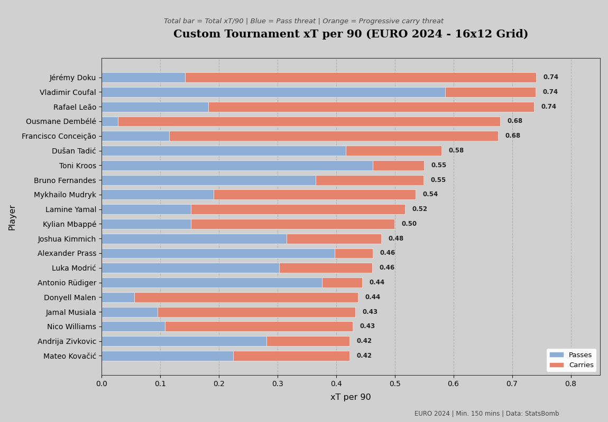
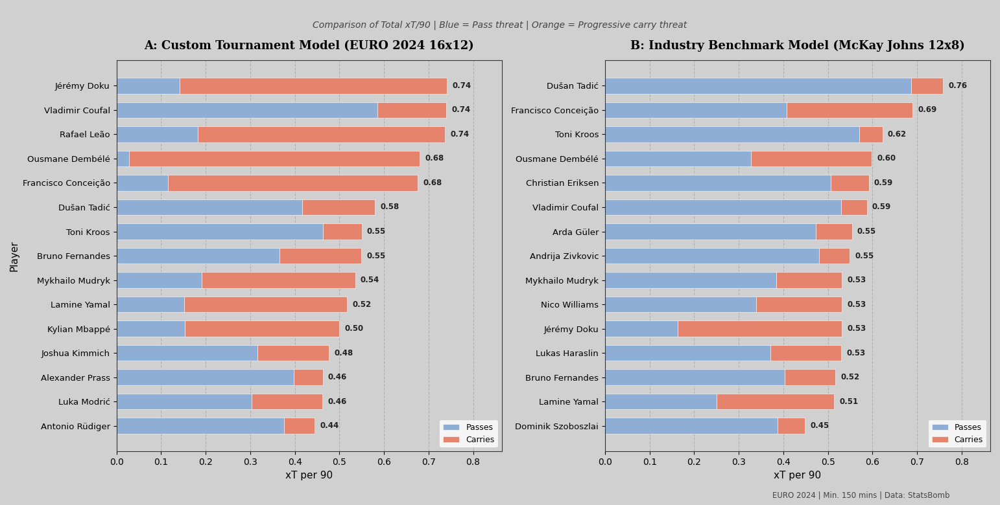

# Expected Threat (xT) Spatial Modelling & Pass Valuation — EURO 2024


An end-to-end spatial data science project evaluating player progression and threat creation during **UEFA EURO 2024** using raw StatsBomb event data. 

The project features:
1. **A Custom Tournament-Specific Model ($16 \times 12$ Grid):** Trained directly on EURO 2024 micro-events using Markov chains to capture short-tournament transition dynamics.
2. **An Industry Benchmark Model ($12 \times 8$ Grid):** Implemented using the calibrated Karun Singh / McKay Johns framework for comparative baseline analysis.
3. **Action Decomposition (Passes vs. Carries):** Decoupling spatial threat generated via distribution versus progressive ball carries per 90 minutes.

---

## 📊 Visualizations

### 1. Custom Tournament Model (EURO 2024 — $16 \times 12$ Grid)
Top creators per 90 minutes (minimum 150 minutes played), split into passing threat and progressive carries:



### 2. Methodological Comparison: Custom ($16 \times 12$) vs. Benchmark ($12 \times 8$)
Side-by-side comparison illustrating how tournament-fitted transitions prioritize dynamic wide carries compared to league-calibrated distribution baselines:



---

## 🧠 What is Expected Threat (xT)?

Traditional metrics (goals, assists, key passes) heavily bias credit toward the final touch. **Expected Threat (xT)** is a possession-value model that measures how much a player increases their team's probability of scoring by moving the ball from location $A$ to location $B$.

### Mathematical Formulation
The pitch is discretized into a grid of zones. In any given zone $(x, y)$, a player can either **shoot** or **move the ball** (via pass or carry):

$$xT(x, y) = \underbrace{P(\text{Shot}) \times P(\text{Goal} \mid \text{Shot})}_{\text{Direct Threat}} + \underbrace{P(\text{Move}) \times \sum_{(x', y')} \Big( T_{(x, y) \to (x', y')} \times xT(x', y') \Big)}_{\text{Future Threat}}$$

Where:
* $P(\text{Shot})$ is the probability of taking a shot from zone $(x, y)$.
* $P(\text{Goal} \mid \text{Shot})$ is the probability of a shot resulting in a goal from zone $(x, y)$.
* $P(\text{Move})$ is the probability of choosing to move the ball rather than shoot.
* $T_{(x, y) \to (x', y')}$ is the transition probability of moving the ball from $(x, y)$ to $(x', y')$.

Action valuation is computed as the net threat added:
$$\Delta xT = xT_{\text{end}} - xT_{\text{start}}$$

---

## 🔬 Methodology & Model Comparison

| Feature | Model A: Custom Tournament Model | Model B: Industry Benchmark |
| :--- | :--- | :--- |
| **Grid Resolution** | $16 \times 12$ (7.5m $\times$ 6.6m cells) | $12 \times 8$ (10m $\times$ 10m cells) |
| **Training Sample** | 51 matches (EURO 2024 raw events) | Multi-season league sample (Karun Singh baseline) |
| **Pass Valuation** | Net $\Delta xT$ (penalizes backward retention) | Net $\Delta xT$ |
| **Carry Valuation** | Progressive forward carries ($\ge 3.0$ m, $\Delta xT \ge 0$) | Progressive forward carries ($\ge 3.0$ m, $\Delta xT \ge 0$) |
| **Playing Time** | Precise minutes calculated via lineups & substitutions | Standardized match minutes |

### Analytical Rationale
* **The Benchmark Model ($12 \times 8$)** favors deep-lying orchestrators (e.g., Dušan Tadić, Christian Eriksen, Toni Kroos) whose value stems from sustained diagonal switches and final-third entries in structured possession.
* **The Custom Model ($16 \times 12$)** captures the tournament reality of EURO 2024, where compact defensive low-blocks necessitated 1v1 wing isolation and dynamic carries into the box (e.g., Jérémy Doku, Rafael Leão, Ousmane Dembélé).

---

## 📁 Repository Structure

```text
├── euro_2024_events.parquet    # Raw StatsBomb event dataset
├── data_processing.py          # Data ingestion, coordinate transforms & minute calculation
├── model.py                    # ExpectedThreatModel implementation (Markov chain & benchmark)
├── visualization.py            # Matplotlib styling, stacked charts & comparison plots
├── main.py                     # Execution pipeline running both methodologies
├── visuals/                    # Generated charts and exported graphics
│   ├── tournament_xt_top20.png
│   └── model_comparison.png
├── requirements.txt            # Python dependencies
└── README.md                   # Project documentation